# newsprint

A black & white colorscheme for Neovim, set like a newspaper.

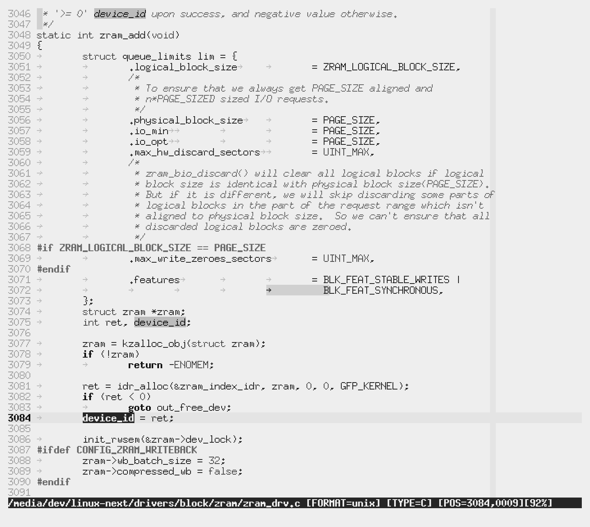

One ink, many tints. Instead of colour, structure is carried the way a
broadsheet carries it:

| On the page | In the editor | How it's set |
|---|---|---|
| Headlines | keywords, labels, `sizeof`; the function being defined (tree-sitter), the commit summary, the mail subject, the function named in a hunk header | **bold** solid ink |
| Body copy | identifiers, function calls, operators | ink |
| Secondary matter | types, `static`/`struct`, strings, numbers, constants | dark grey |
| Captions | comments, `#if 0` blocks, `#include`/`#define`, older quotes in mail | *italic* grey |
| Rules and margins | tab markers, window separators, line numbers, `~` | light grey |
| Halftone screens | cursor line, `colorcolumn`, selection, search hits, menus, floats, added lines in patches | grey tints behind the text |
| Reverse type | status bar, current search hit, selected menu item, error messages, `TODO`/`FIXME`/`XXX`, EasyMotion targets | white on black |

Every grey sits exactly on the xterm-256 grey ramp (indices 233–255), so a
256-colour terminal (`notermguicolors`) prints the very same page as a
truecolor one, and palette entries 0–15 are never used. With `termguicolors`
the paper also gets a faint newsprint warmth.

## Install

With vim-plug:

```vim
Plug '/media/dev/newsprint'
```

or put the repository on the runtime path, or symlink (or copy) the files in
`colors/` into `~/.config/nvim/colors/`: the variants load `newsprint.lua`
from their own directory. Then, in `~/.config/nvim/init.vim`:

```vim
set background=light       " morning edition: ink on newsprint (dark: night edition)
colorscheme newsprint      " or one of the variants below
```

`:hi` commands that come after `colorscheme` in your config override the
theme; drop any `CursorLine`/`ColorColumn`/`MatchParen` overrides.

## Variants

Each is its own colorscheme, so `:colorscheme newsprint<Tab>` cycles through
them:

| `:colorscheme` | |
|---|---|
| `newsprint` | black & white |
| `newsprint-duotone` | slate keywords, rosewood numbers and constants, comments in sidebars |
| `newsprint-sunday` | duotone, plus sage strings and ochre preprocessor |
| `newsprint-duotone-faded` | `newsprint-duotone` in the original, more muted slate and rosewood |
| `newsprint-sunday-faded` | `newsprint-sunday` in the original, more muted slate and rosewood |

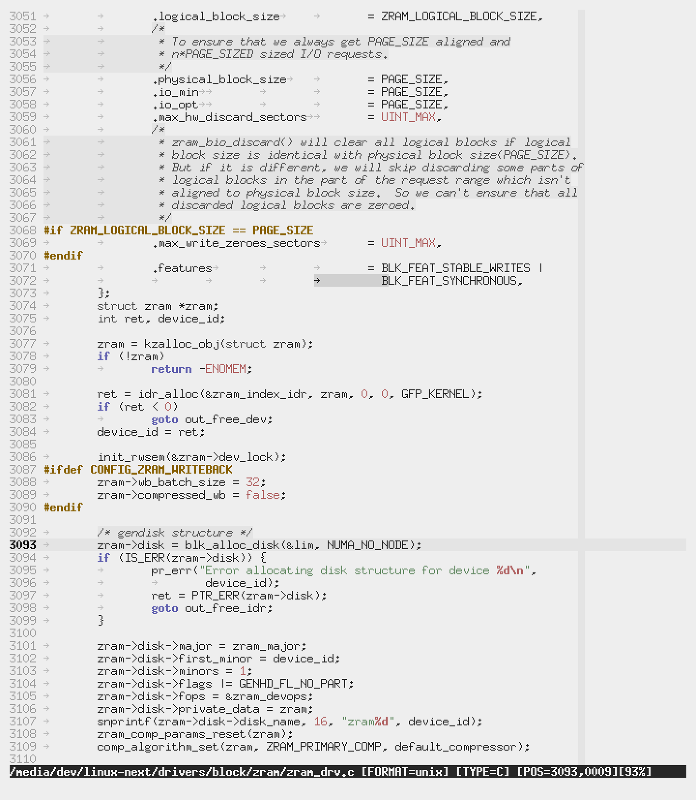

Screenshots of every variant on the same code:
[newsprint](screenshots/variant-newsprint.png),
[duotone-faded](screenshots/variant-newsprint-duotone-faded.png),
[duotone](screenshots/variant-newsprint-duotone.png),
[sunday-faded](screenshots/variant-newsprint-sunday-faded.png),
[sunday](screenshots/variant-newsprint-sunday.png),
[sunday at night](screenshots/variant-newsprint-sunday-night.png),
[sunday on truecolor with tree-sitter](screenshots/variant-newsprint-sunday-truecolor.png).

Your `g:newsprint` options (below) still apply to a variant, except the ones
the variant sets itself, so `let g:newsprint = {'accent': 'red'}` with
`colorscheme newsprint-sunday` gives the Sunday edition with the red pencil.

## Options

All optional; set them before `colorscheme`.

```lua
vim.g.newsprint = {
  bold        = true,       -- bold keywords and headlines
  italic      = true,       -- italic comments and captions
  warm        = true,       -- warm newsprint paper (truecolor only)
  transparent = false,      -- keep the terminal's own background
  inks        = 'black',    -- 'duotone' or 'sunday': muted tinted inks
  faded       = false,      -- the original, more muted slate and rosewood
  comments    = 'caption',  -- 'sidebar': comments in a shaded box
  accent      = false,      -- 'red' or 'desk': spot colour for events
}
```

From Vim script: `let g:newsprint = {'inks': 'duotone', 'comments': 'sidebar'}`.
To try a setting in a running Neovim, set it and run `:colorscheme newsprint`
again; `:set background=dark` switches editions at any time.

### Tinted inks and sidebar comments

A colour supplement printed on the same newsprint: a few muted, desaturated
inks over the black. Headlines and the UI stay black & white.

| Ink | Used for | light | night |
|---|---|---|---|
| Slate (grey-blue) | keywords, bold | `61` #5f5faf | `104` #8787d7 |
| Rosewood (grey-red) | numbers, `true`/`false`, `NULL`, constants; `%d`/`\n` in strings, bold | `131` #af5f5f | `174` #d78787 |
| Sage (`sunday`) | strings | `65` #5f875f | `108` #87af87 |
| Ochre (`sunday`) | `#include`/`#define`; `#if`/`#endif`, bold | `94` #875f00 | `137` #af875f |
| Sidebar box (`comments = 'sidebar'`) | comments: dark grey italic on the lightest screen | `254` #e4e4e4 | `235` #262626 |

`inks = 'duotone'` is slate and rosewood; `'sunday'` adds sage and ochre.
`faded = true` restores the original, more muted slate and rosewood, one step
down the colour cube: `60` #5f5f87 and `95` #875f5f (night: `103` #8787af and
`138` #af8787).

More: [duotone without sidebars](screenshots/inks-duotone.png),
[how bright the inks should be](screenshots/inks-brightness-compare.png).

### Spot colour

Colour never decorates here: it only marks an event, the way an editor marks
up a proof, with the tools on an editor's desk.

| Ink | Marks | light | night |
|---|---|---|---|
| Red pencil | what's wrong: error messages and diagnostics, syntax errors, `TODO`/`FIXME`/`XXX`, deleted lines, whitespace errors, an over-long commit summary, misspellings (truecolor) | `124` #af0000, `224` #ffd7d7 | `167` #d75f5f, `52` #5f0000 |
| Yellow highlighter | search hits | `229` #ffffaf | `178` #d7af00 |
| Non-repro blue | what isn't part of the text: the visual selection, Copilot suggestions, hints | `67` #5f87af, `153` #afd7ff | `110` #87afd7, `24` #005f87 |

`accent = 'red'` is the red pencil alone, a newspaper's classic second colour;
`accent = 'desk'` adds the highlighter and the blue pencil.

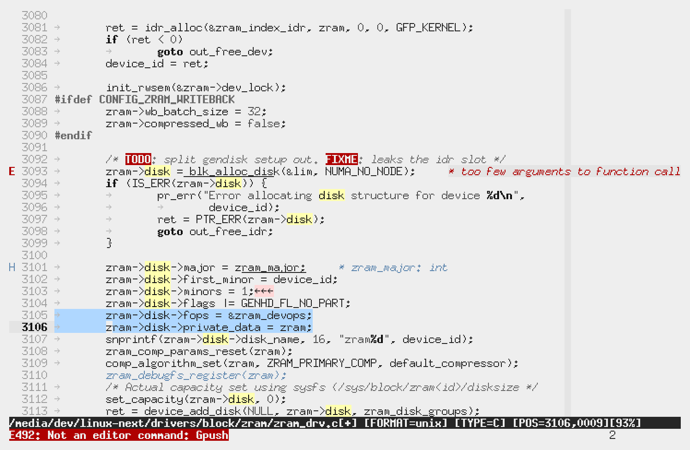

More: [black & white](screenshots/accent-none.png),
[red only](screenshots/accent-red.png), [a patch](screenshots/accent-desk-patch.png),
[night](screenshots/accent-desk-night.png), [truecolor](screenshots/accent-desk-truecolor.png).

## Gallery

A patch, with added lines on a screen and removed ones in grey:
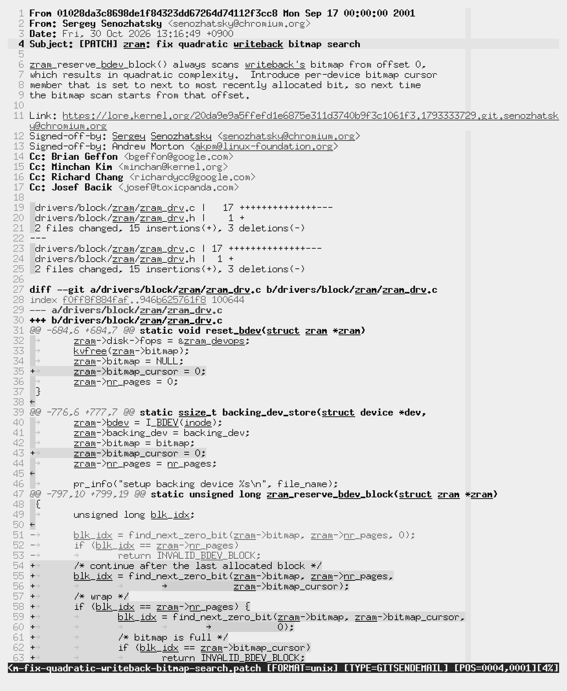

A mutt reply, with older quotes fading like old news:
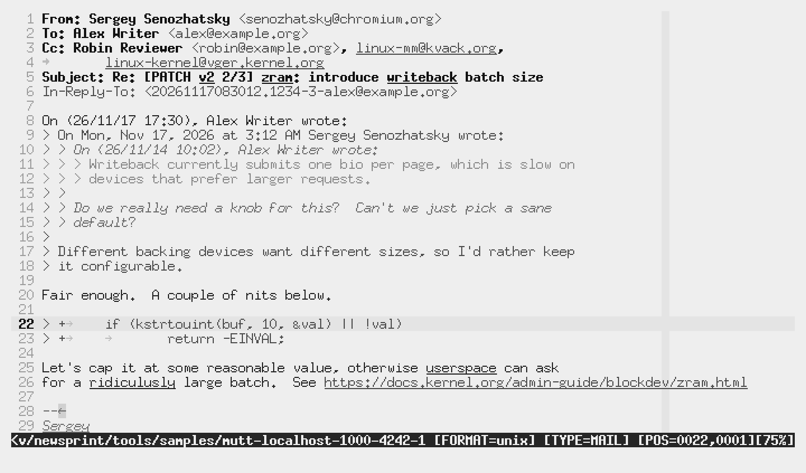

A commit message:
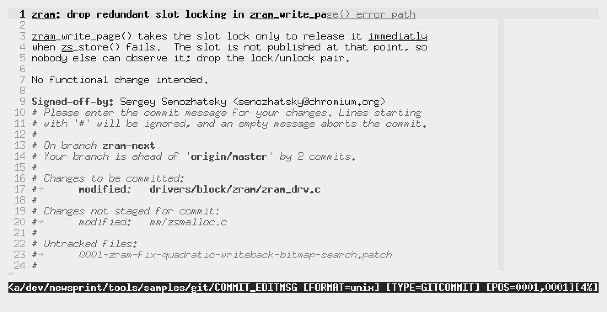

Splits, diagnostics, a float and the completion menu, light and night:
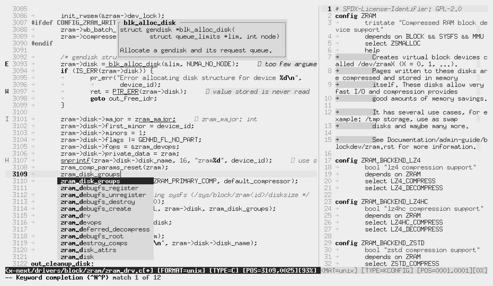
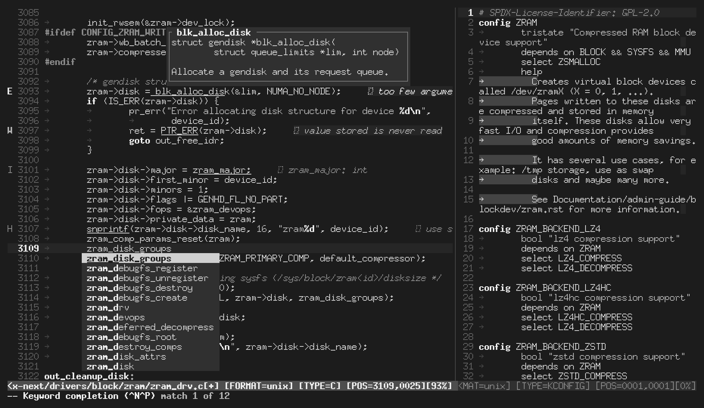

Tabs, a fold, a selection; EasyMotion:
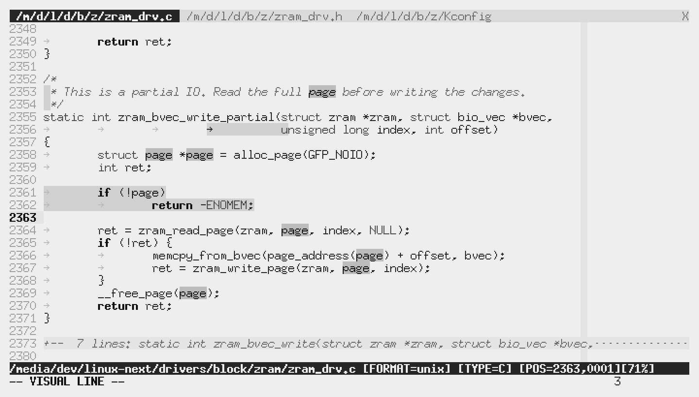
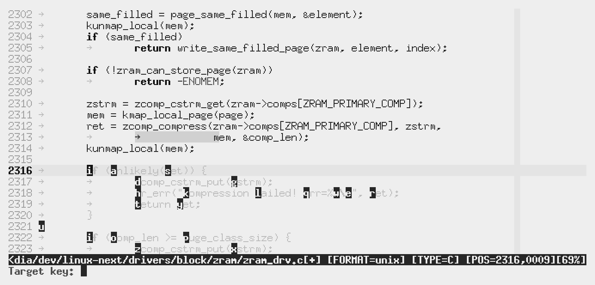

Truecolor with tree-sitter, where definitions print as headlines and
parameters in italic; and the same urxvt page with an anti-aliased font:
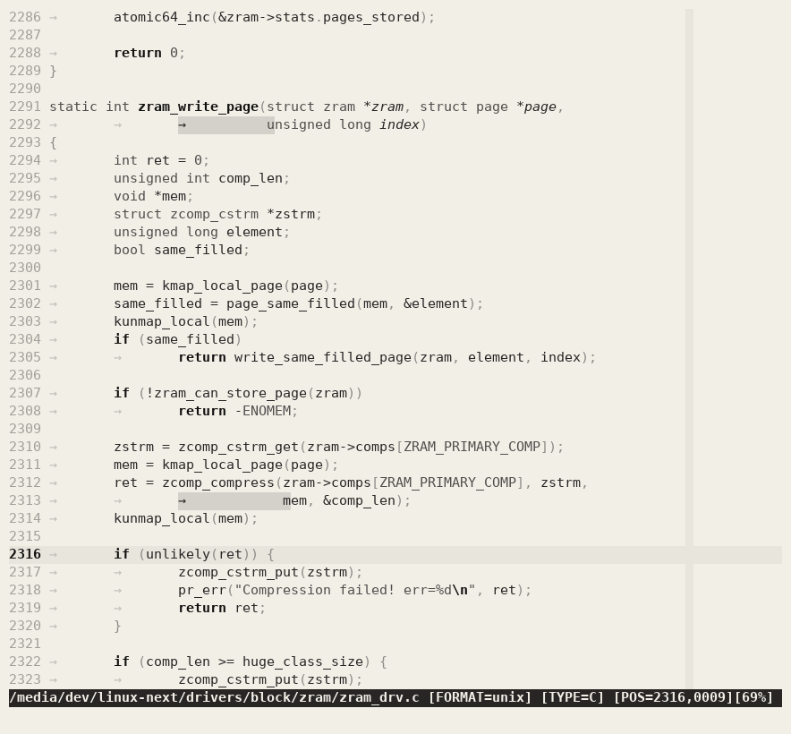
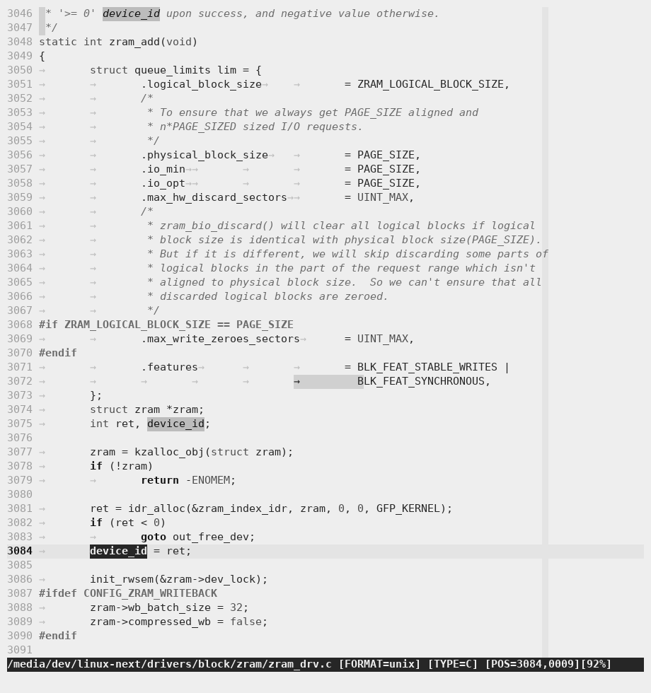

## Coverage

Legacy syntax (including vim-polyglot's C/diff/gitcommit/mail/Kconfig
groups), tree-sitter captures, LSP semantic tokens and diagnostics,
`diff`/`gitsendemail` patches, `gitcommit`, `mail`, help, markdown,
vim-fugitive, vim-easymotion, copilot.vim, `LinuxError` from linuxsty.vim and
a `LeadingWS` whitespace-error group, and `:terminal` colours.

## Terminal notes

* Anti-aliasing is up to the terminal, not Neovim. Bitmap fonts such as
  misc-fixed are never anti-aliased. For smooth text in urxvt, use an Xft font
  with greyscale anti-aliasing, so glyphs don't get coloured fringes:

  ```
  urxvt*font:       xft:DejaVu Sans Mono:size=10:antialias=true:hintstyle=hintslight:rgba=none
  urxvt*boldFont:   xft:DejaVu Sans Mono:bold:size=10:antialias=true:hintstyle=hintslight:rgba=none
  urxvt*italicFont: xft:DejaVu Sans Mono:italic:size=10:antialias=true:hintstyle=hintslight:rgba=none
  ```

* A black cursor completes the page: `urxvt*cursorColor: #1c1c1c`.
* If comments don't show in italic with misc-fixed, pin the faces at the width
  of the regular font, e.g.
  `urxvt*italicFont: -misc-fixed-medium-o-normal--13-120-75-75-c-70-iso10646-1`.
* `let g:fugitive_dynamic_colors = 0` keeps `:Git blame` hashes monochrome.
* With vim-polyglot's regex syntax a C function definition can't be told from
  a call, so all names are body text. Tree-sitter (`vim.treesitter.start()`)
  prints definitions as headlines but doesn't grey out `#if 0` blocks.

## Development

`tools/render.py` screenshots a headless Neovim. It attaches to
`nvim --embed` as a UI and paints the grid with Pillow, either as urxvt would
(the X11 misc-fixed bitmap font and the xterm-256 palette) or as a truecolor
terminal would (TrueType font, gui colours). Scenes in `tools/scenes/` set up
what's on screen; `tools/init.lua` is the editor configuration they run in.

```sh
tools/render.py tools/scenes/c_add.lua /tmp/c.png               # as urxvt shows it
NP_OPTS="{ inks = 'sunday' }" tools/render.py tools/scenes/inks.lua /tmp/i.png --bg dark
tools/make-screenshots.sh                                        # rebuild screenshots/
nvim --headless -u NONE -i NONE --cmd 'set rtp^=.' \
     -c 'luafile tools/check-options.lua' -c 'qa!'               # every option and variant
```

The C scenes open `drivers/block/zram` from a kernel tree (`NP_LINUX`,
default `/media/dev/linux-next`). The renderer needs python3 with msgpack and
Pillow.
